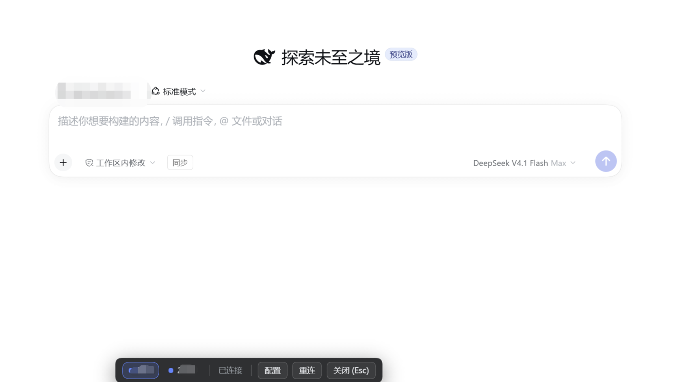

# dsh-remote-bridge

在本地 DSH 窗口里直接使用**远端服务器上的 DSH**：同一个窗口切换多台服务器，agent 在远端执行、消耗远端 token，界面仍是远端原生的 DSH（不重写、不换风格）。

## 界面展示

侧栏底部的「远程」入口（红框处）：


在窗口内使用远端 DSH，底部悬浮条可切换服务器 / 查看状态 / 配置 / 重连 / 关闭：



## 功能

- **窗口内嵌入**：侧栏底部「远程」→ 全窗口显示远端 DSH 界面
- **多台服务器**：界面里随时增删，切换主机不重新加载
- **不用管 token**：插件自动完成远端认证
- **自动拉起**：远端没有运行 `dsh web` 时，自动在远端 tmux 里启动一个
- **底部悬浮条**：默认收起成小胶囊，鼠标移上去展开（切换 / 状态 / 重连 / 配置 / 关闭）
- **Esc 关闭**：焦点在远端页面里也能用 Esc 隐藏

## 环境要求

- 本机：有 OpenSSH 客户端，且能免密登录目标机器（`ssh <别名> true` 直接成功）
- 远端：Linux / macOS，已安装 **Node.js ≥ 24.9**、**dsh**、**tmux**
- 本机 DSH：0.2.x（在 0.2.0-rc.2 上验证）

## 安装

```powershell
pwsh -File scripts\install.ps1
```

手工安装：把本目录复制到 `%USERPROFILE%\.dsh\profiles\node_modules\dsh-remote-bridge\`，
再把 `scripts\cordis.patch.fragment.yml` 的内容追加到 `%USERPROFILE%\.dsh\profiles\desktop\cordis.patch.yml`。

装完**刷新窗口（Ctrl+R）**；若侧栏仍未出现「远程」，完整重启一次 DSH。

## 使用

1. 刷新后，点侧栏底部的「🖥 远程」；
2. 鼠标移到**窗口底部中间**，悬浮条展开；
3. 点「配置」添加服务器：填 `~/.ssh/config` 里的 **SSH 别名**和远端 **dsh web 端口**（默认 `3080`）；
4. 保存后自动连接，左右点主机 tab 切换；
5. 「重连」用于检查/恢复连接（远端没跑会自动用 tmux 拉起）；
6. 「关闭 (Esc)」只是隐藏，会话保留，再打开不用等加载。

## 配置

界面里的配置会保存到 `%USERPROFILE%\.dsh\remote-bridge-hosts.json`：

```json
{
  "version": 1,
  "hosts": [
    { "alias": "XZY", "label": "XZY (zongyao)", "port": 3080, "remoteDir": "/data/zongyao" },
    { "alias": "2903", "label": "2903 (taoyuanhang)", "port": 3080 }
  ]
}
```

| 字段 | 说明 |
|---|---|
| `alias` | `~/.ssh/config` 里的 Host 名（必填） |
| `label` | 界面显示名，缺省用 alias |
| `port` | 远端 `dsh web` 端口，默认 `3080`（各服务器互相独立，可以都一样） |
| `remoteDir` | 远端工作目录，可留空（默认 `$HOME`） |

也可以在 profile 的 `cordis.patch.yml` 里写默认 `hosts`（没有上面那个文件时生效），格式见
`scripts/cordis.patch.fragment.yml`。

## 常见问题

| 现象 | 处理 |
|---|---|
| 侧栏没有「远程」 | 刷新页面；仍没有就重启 DSH |
| 一直「正在连接远端…」 | 确认 `ssh <别名> true` 能通；远端需装 `tmux` |
| 页面提示 authentication required | 点悬浮条上的「重连」重新认证 |
| 升级 DSH 后插件失效 | 重跑一次 `install.ps1`，重启 DSH |

## 卸载

```powershell
pwsh -File scripts\uninstall.ps1
```

## License

MIT
